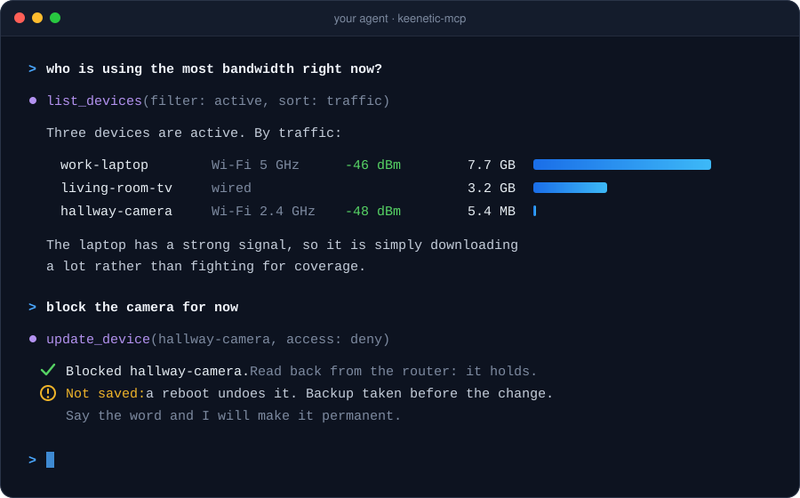
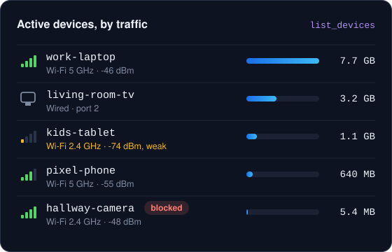
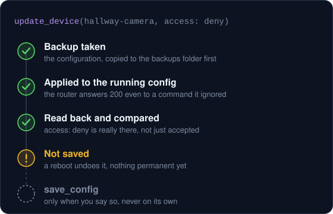
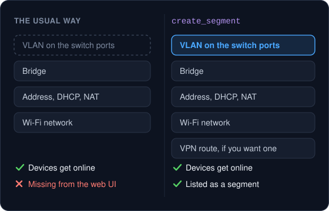
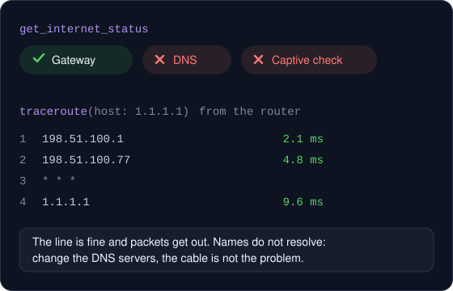
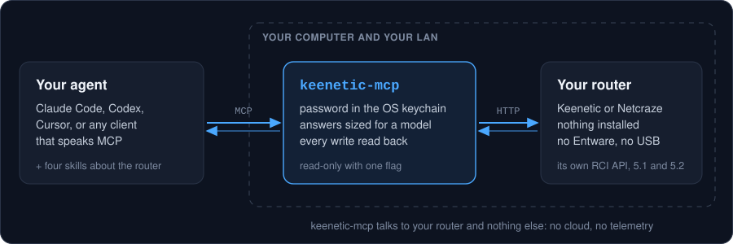

<p align="center">
  
</p>

<h1 align="center">keenetic-mcp</h1>

<p align="center">
  <b>Your Keenetic or Netcraze router, in plain language.<br>
  Ask Claude, Codex, Cursor or any MCP agent who is on your network, why the internet is down,<br>
  or for a guest Wi-Fi. Nothing to install on the router.</b>
</p>

<p align="center">
  <a href="https://www.npmjs.com/package/keenetic-mcp"></a>
  <a href="https://www.npmjs.com/package/keenetic-mcp"></a>
  <a href="https://github.com/salatmaster/keenetic-mcp/actions/workflows/ci.yml"></a>
  <a href="#supported-routers"></a>
  <a href="LICENSE"></a>
</p>

<p align="center">
  
</p>

The web interface answers one question per page, and "why is the internet slow" is spread across five
of them. **keenetic-mcp** gives your agent the router's own API, so it reads all five at once, tells you
what it found, and makes the change you ask for, carefully: nothing is saved until you say so, and
every change is read back from the router before it is reported as done.

It runs on your computer and talks to the router over your LAN. No USB drive, no Entware, no firmware
modification, no cloud. Netcraze routers run the same firmware under their own brand, so everything here
applies to them as well.

## Get started

**Claude Code**

```
/plugin marketplace add salatmaster/keenetic-mcp
/plugin install keenetic@keenetic
npx -y keenetic-mcp init
```

**Codex**

```
codex plugin marketplace add salatmaster/keenetic-mcp
codex plugin add keenetic@keenetic
npx -y keenetic-mcp init
```

The plugins bring four skills along with the server. For the server on its own, `codex mcp add keenetic
-- npx -y keenetic-mcp`.

**Cursor, Claude Desktop, anything else**

```json
{
  "mcpServers": {
    "keenetic": { "command": "npx", "args": ["-y", "keenetic-mcp"] }
  }
}
```

and run `npx -y keenetic-mcp init` once.

The wizard finds your router from the default gateway, confirms it really is a Keenetic or Netcraze, checks the
password against it, and stores the password in your operating system keychain. Only the address and
login go in a settings file. In a container, `KEENETIC_HOST`, `KEENETIC_USER` and `KEENETIC_PASSWORD`
override everything.

## Features



### Every device, at a glance

Who is online, how each device is connected, how strong its signal is and how much it has downloaded,
ranked the way you asked. Then rename a device, block it, put it on a schedule or a VPN policy, or
give it priority, in the same conversation.

<br clear="all">
<br>



### Changes you can take back

The router answers a wrong command with HTTP 200 and changes nothing, so every write is read back and
compared before the agent tells you it worked. A backup is taken before the first change, and nothing
is saved until you say so: if something goes wrong, a reboot undoes it.

<br clear="all">
<br>



### A guest network that actually shows up

Build a bridge, an address and a Wi-Fi network, and you get a guest network that carries traffic
perfectly and never appears in the web interface: a segment is VLAN-backed, and the VLAN is the part
everyone leaves out. `create_segment` builds all of it, with its own Wi-Fi, DHCP and, if you want, a
route through your VPN. `delete_segment` removes everything it created.

<br clear="all">
<br>



### Diagnostics from the router's side

Which check failed when the internet is down: the gateway, DNS or the captive portal check. `ping` and
`traceroute` run on the router itself, so they show the path your network takes, not your laptop's,
and can go out through a specific interface such as a VPN tunnel.

<br clear="all">
<br>

**Also:**

- **Read-only with one flag.** With `--read-only` the write tools are not registered at all, so the
  agent never sees them, and `rci_call` refuses anything but reads.
- **Skills that know the router.** The plugins ship four: the API tree and its traps, the safe change
  workflow, segments, and a step-by-step troubleshooting playbook.
- **An escape hatch.** `rci_call` reaches any API path, for whatever the tools do not cover.
- **Answers sized for a model.** The raw interface listing alone is 32 KB and the NAT table is over
  100 KB; the tools return what the question needs.

## How it works

<p align="center">
  
</p>

Keenetic and Netcraze routers expose RCI, a JSON mirror of their command-line tree, over HTTP. keenetic-mcp logs in
with the router's challenge-response scheme, keeps one session alive across the agent's questions, and
shapes the answers so they fit in a model's context. There is no coherent public documentation for
RCI, so [docs/rci-api.md](docs/rci-api.md) collects what was learned building this: the login, the paths
that exist, the traps, and how to recover a command's syntax from the router itself.

## Tools

**Read**

| Tool | |
|---|---|
| `list_devices` | every device, filtered by active, wired, wireless or blocked, sorted by traffic or signal |
| `get_device` | one device in full: lease, Wi-Fi rate, policy, schedule, traffic |
| `list_interfaces` | WAN links, bridges, access points, VPN tunnels |
| `get_interface` | one interface in full, including WireGuard peers |
| `get_wifi_status` | radios by band, with client counts |
| `get_internet_status` | reachability, and which check failed |
| `ping` | ICMP echo from the router, optionally through a given interface |
| `traceroute` | the path from the router, optionally from a given interface or source address |
| `list_routes` | routing table, or just the default route |
| `list_policies` | connection policies for selective routing |
| `get_system_info` | model, firmware, CPU, memory, installed components |
| `get_config_state` | unsaved changes, who changed what and when |
| `list_segments` | every bridge, and whether the web interface lists it as a segment |
| `backup_config` | download the configuration into the backups folder |

**Change**

| Tool | |
|---|---|
| `update_device` | rename, block or allow, assign a routing policy, schedule or priority |
| `set_interface_state` | bring an interface up or down |
| `create_segment` | a guest or IoT network the web interface actually lists, with Wi-Fi, DHCP and optional VPN routing |
| `delete_segment` | remove a segment and everything created with it |
| `save_config` | make pending changes survive a reboot |

**Escape hatch**

| Tool | |
|---|---|
| `rci_call` | any router API path, for whatever the tools above do not cover |

## Skills

One plugin directory serves both Claude Code and Codex: they read different manifests but share the
same skills and the same server definition.

- **keenetic-rci** teaches the router's API tree: which paths exist, which ones return 100 KB, and how
  to recover the exact syntax of a command from the router's own configuration.
- **keenetic-safe-changes** teaches the change workflow: what the router's fail-safe does and does not
  protect against, and which interfaces will cut off your own access.
- **keenetic-segments** covers building an isolated network the router will admit exists.
- **keenetic-troubleshoot** is an ordered playbook for "the internet is down", "Wi-Fi is bad" and "one
  device cannot connect".

## Safety

- **Nothing is saved unless you ask.** Changes apply to the running configuration and are discarded on
  reboot until `save_config` is called. The server never calls it on its own.
- **A backup is taken automatically** before the first change of a session, into the backups folder,
  readable by you only.
- **Every change is verified** by reading it back before it is reported as successful.
- **Read-only mode really is read-only.** The write tools are not registered rather than registered and
  refusing.
- **Your password goes in the system keychain**, not in a config file, and never in a log or a tool
  response.
- **LAN only.** No cloud, no telemetry, no connection to anything but your router.

Where the password is stored on each platform, and how to report something privately, are in
[SECURITY.md](SECURITY.md).

## Supported routers

Keenetic and Netcraze routers run the same firmware, KeeneticOS, and RCI is a standard part of it
rather than a feature of expensive models, and the tool set adapts
to the components each router actually has. Tried so far:

| Router | Firmware | What was checked |
|---|---|---|
| Keenetic Ultra (KN-1811) | 5.1.3 | everything, the router it was built against |
| Keenetic Hopper DSL (KN-3610) | 5.1.8 | backups |
| Keenetic Sprinter (KN-3710) | 5.2 Beta 3 | `ping` and `traceroute` |
| Keenetic Hopper (KN-3810) | 5.2 Beta 4 | the ndw4 login, everyday use |
| Netcraze Speedster (NC-3013) | 5.2 Beta 1 | setup, system info, internet status, devices |

Other models on the 5.1 branch: Giga (KN-1010), Hero (KN-1011, KN-1012), Start and Starter (KN-1111,
KN-1112, KN-1121), Air and Explorer (KN-1613, KN-1621), Extra and Carrier (KN-1713, KN-1714, KN-1721),
Ultra and Titan (KN-1810, KN-1812). Older hardware on 4.x and earlier has RCI too. If yours works, or
does not, an issue saying so helps the next person.

**On 5.2, use Node 24.7 or later.** Newer 5.2 builds accept only the ndw4 login, which needs it. On
older Node the server falls back to the previous login, which 5.1 accepts and 5.2 may not.

## Contributing

```
npm install
npm test          # no router required
```

Bug reports and pull requests are welcome, and reports from models nobody has tried yet most of all.
[CONTRIBUTING.md](CONTRIBUTING.md) covers testing against a real router, fixtures, releases and the one
rule that matters most here.

## License

[MIT](LICENSE). Not affiliated with Keenetic or Netcraze.
