<h1 align="center">keenetic-mcp</h1>

<p align="center">
  <b>VPN routing, separate networks and per-device rules on a Keenetic or Netcraze router,<br>
  set up in one sentence to Claude, Codex or Cursor. Checked on the router, and undone by a reboot<br>
  until you say it is right.</b>
</p>

<p align="center">
  <a href="https://www.npmjs.com/package/keenetic-mcp"></a>
  <a href="https://www.npmjs.com/package/keenetic-mcp"></a>
  <a href="https://github.com/salatmaster/keenetic-mcp/actions/workflows/ci.yml"></a>
  <a href="#supported-routers"></a>
  <a href="LICENSE"></a>
</p>

<p align="center">
  <a href="#install">Install</a> ·
  <a href="#what-to-ask">What to ask</a> ·
  <a href="#why-changes-are-safe">Safety</a> ·
  <a href="#tools">Tools</a> ·
  <a href="#supported-routers">Supported routers</a> ·
  <a href="#faq">FAQ</a>
</p>

Sending two devices through a VPN on a Keenetic means a connection policy, the right interfaces
permitted in it, and every device assigned to it by hand. A separate network for smart home devices
means a VLAN on every switch port, a bridge, addressing, DHCP, NAT, Wi-Fi and isolation, and missing
any one of them gives you a network that half works. **keenetic-mcp** gives your AI agent the router's
own API and the knowledge of where it bites, so you describe the result and the agent builds it.

<p align="center">
  
</p>
<p align="center"><sub>A composed session, not a recording: the tool calls, their arguments and the shape of every answer are the server's own, the home network is made up. <a href="docs/demo/scene.py">Source</a>.</sub></p>

<table>
<tr>
<td width="33%" valign="top">

**One sentence, not twelve pages**

VPN for some devices and not others, a guest or smart home network the web interface actually lists,
a device on a schedule. The agent finds the policies, devices and free addresses itself.

</td>
<td width="33%" valign="top">

**Nothing breaks for good**

The built-in tools take a backup first and read every change back from the router before reporting it,
and nothing is saved until you say so. If something is off, a reboot puts everything back.

</td>
<td width="33%" valign="top">

**Nothing on the router**

It runs on your computer and talks to the router's own API over your LAN. No Entware, no USB drive, no
firmware modification, no cloud. The password stays in your system keychain.

</td>
</tr>
</table>

## Install

**Claude Code**

```
/plugin marketplace add salatmaster/keenetic-mcp
/plugin install keenetic@keenetic
npx -y keenetic-mcp init
```

**Codex**

```
codex plugin marketplace add salatmaster/keenetic-mcp
codex plugin add keenetic@keenetic
npx -y keenetic-mcp init
```

**Cursor, Claude Desktop and any other MCP client**

```json
{
  "mcpServers": {
    "keenetic": { "command": "npx", "args": ["-y", "keenetic-mcp"] }
  }
}
```

then run `npx -y keenetic-mcp init` once.

The wizard finds the router from your default gateway, checks that it really is a Keenetic or Netcraze,
tries the password against it and puts the password in the operating system keychain. The plugins also
bring four skills that teach the agent how the router really behaves. In a container, set
`KEENETIC_HOST`, `KEENETIC_USER` and `KEENETIC_PASSWORD` instead.

**Several routers.** Home, your parents' and the office can all sit at `192.168.1.1` with the login
`admin`. Give each one a name with `npx -y keenetic-mcp init --profile parents`, and choose which one a
session talks to with `KEENETIC_PROFILE`. For one Claude Code project, that is a line in its
`.claude/settings.local.json`:

```json
{ "env": { "KEENETIC_PROFILE": "parents" } }
```

Without a profile the server uses the router `init` set up without one. Other clients can pass
`--profile parents` in the server's `args`, or set `KEENETIC_PROFILE` in its `env`.

## What to ask

**Routing**

- *Put the TV and my work laptop on the WireGuard VPN, everything else stays direct.*
- *Which devices go through the VPN right now?*
- *Move the phone to the VPN as well.*

**Separate networks**

- *Give the smart home stuff its own Wi-Fi that can't see my home network.*
- *Make a guest network that goes out through the VPN.*
- *Remove the IoT network and everything that came with it.*

**Devices**

- *Who is using the most bandwidth right now?*
- *Block the camera until I say otherwise.*
- *Put the kids' tablet on the bedtime schedule.*

**When something is wrong**

- *The internet is down. Why?*
- *Is it the router or the provider? Trace the route to github.com from the router.*
- *What changed on the router today, and is any of it unsaved?*

Anything the built-in tools do not cover, such as a new WireGuard tunnel or routing by domain, goes
through `rci_call`, the router's full API. The `keenetic-rci` skill shows the agent how to find the exact
command in the router's own configuration instead of guessing it, and those changes are not saved until
you say so either.

## Why changes are safe

- **Backup first.** Before the first change of a session, the configuration is downloaded into the
  backups folder, readable by you only.
- **Checked on the router.** A Keenetic answers a wrong command with HTTP 200 and changes nothing, so
  every change the built-in tools make is read back and compared before the agent hears it worked. Creating a segment takes
  about twenty commands; if one fails, all of them are rolled back.
- **Nothing permanent until you say so.** Changes go to the running configuration only, so a reboot
  undoes them. The server never calls `save_config` on its own.
- **Read-only when you want it.** With `--read-only` the write tools are not registered at all, so
  the agent never sees them, and `rci_call` refuses anything but reads.
- **Your password stays yours.** It lives in the system keychain, never in a config file, a log or a
  tool response.

Where the password is stored on each platform, and how to report something privately, are in
[SECURITY.md](SECURITY.md).

## Tools

**Change**

| Tool | |
|---|---|
| `update_device` | rename, block or allow, put on a routing policy, a schedule or a priority |
| `create_segment` | a guest or IoT network the web interface lists, with its own Wi-Fi, DHCP, isolation and optional VPN routing |
| `delete_segment` | remove a segment and everything created with it |
| `set_interface_state` | bring an interface up or down |
| `save_config` | make pending changes survive a reboot |

**Read**

| Tool | |
|---|---|
| `list_devices`, `get_device` | every device, by traffic, signal or name; one device in full |
| `list_policies` | routing policies and the links each one allows |
| `list_segments` | every network, and whether the web interface lists it |
| `list_interfaces`, `get_interface` | WAN links, bridges, access points, VPN tunnels with their peers |
| `get_wifi_status` | radios by band, with client counts |
| `get_internet_status` | whether the router is online, and which check failed if not |
| `ping`, `traceroute` | run on the router itself, optionally through a given interface |
| `list_routes` | the routing table, or just the default route |
| `get_system_info` | model, firmware, CPU, memory, installed components |
| `get_config_state` | unsaved changes, who changed what and when |
| `backup_config` | download the configuration into the backups folder |

**Everything else**

| Tool | |
|---|---|
| `rci_call` | any path of the router's API |

## Skills

The plugins for Claude Code and Codex share four skills:

- **keenetic-rci**: the API tree, which paths return 100 KB, and how to recover a command's exact
  syntax from the router's own configuration.
- **keenetic-safe-changes**: what the router's own fail-safe does and does not cover, and the order of
  changes that does not cut off your own access.
- **keenetic-segments**: why the obvious way to build a guest network gives one the web interface never
  lists, and the VLAN it is missing.
- **keenetic-troubleshoot**: an ordered playbook for "the internet is down", "Wi-Fi is bad" and "one
  device cannot connect".

## Supported routers

Keenetic and Netcraze routers run the same firmware, and its API is part of every model rather than of
expensive ones. The tool set adapts to what each router actually has. Tried so far:

| Router | Firmware | What was checked |
|---|---|---|
| Keenetic Ultra (KN-1811) | 5.1.3 | everything, the router it was built against |
| Keenetic Hopper DSL (KN-3610) | 5.1.8 | backups |
| Keenetic Sprinter (KN-3710) | 5.2 Beta 3 | `ping` and `traceroute` |
| Keenetic Hopper (KN-3810) | 5.2 Beta 4 | the 5.2 login, everyday use |
| Netcraze Speedster (NC-3013) | 5.2 Beta 1 | setup, system info, internet status, devices |

Other models on 5.1: Giga (KN-1010), Hero (KN-1011, KN-1012), Start and Starter (KN-1111, KN-1112,
KN-1121), Air and Explorer (KN-1613, KN-1621), Extra and Carrier (KN-1713, KN-1714, KN-1721), Ultra and
Titan (KN-1810, KN-1812). If yours works, or does not, an issue saying so helps the next person.

**On 5.2, use Node 24.7 or later.** Newer 5.2 builds accept only the ndw4 login, which needs it. On
older Node the server falls back to the previous login, which 5.1 accepts and 5.2 may not.

## FAQ

<details>
<summary><b>Does my network data go to the cloud?</b></summary>

<br>

keenetic-mcp itself connects to nothing but your router: no cloud, no telemetry. What the tools return
does go to your agent's model, the same as anything else you show it. The answers are trimmed to what the
question needs, and the password is never in them.

</details>

<details>
<summary><b>Can it lock me out of my own router?</b></summary>

<br>

Every change is in the running configuration only, so a reboot brings back the saved one. The router
also has its own fail-safe that reverts a change when it loses the management session. The
`keenetic-safe-changes` skill tells the agent which changes can cut off your own access, such as the
interface you are connected through, and to ask before them.

</details>

<details>
<summary><b>Can I let it look but not touch?</b></summary>

<br>

Start the server with `--read-only`. The write tools are then not registered at all, and `rci_call`
refuses anything but reads.

</details>

<details>
<summary><b>How is this different from the web interface or the app?</b></summary>

<br>

They show one setting per page. Here the agent reads everything it needs at once, so "why is the
internet slow" or "put these two on the VPN" is one question instead of a walk through five pages, and
the agent knows the traps those pages hide, such as the guest network that never appears in the list.

</details>

## How it works

Keenetic and Netcraze routers expose RCI, a JSON mirror of their command-line tree, over HTTP.
keenetic-mcp logs in with the router's challenge-response scheme, keeps one session alive across the
agent's questions, and shapes the answers to fit a model's context: the raw interface listing alone is
32 KB, and the NAT table is over 100 KB. There is no coherent public documentation for RCI, so
[docs/rci-api.md](docs/rci-api.md) collects what was learned building this: the login, the paths that
exist, the traps, and how to recover a command's syntax from the router itself.

## Contributing

```
npm install
npm test          # no router required
```

Bug reports and pull requests are welcome, and reports from models nobody has tried yet most of all.
[CONTRIBUTING.md](CONTRIBUTING.md) covers testing against a real router, fixtures, releases and the
one rule that matters most here.

## License

[MIT](LICENSE). Not affiliated with Keenetic or Netcraze.
